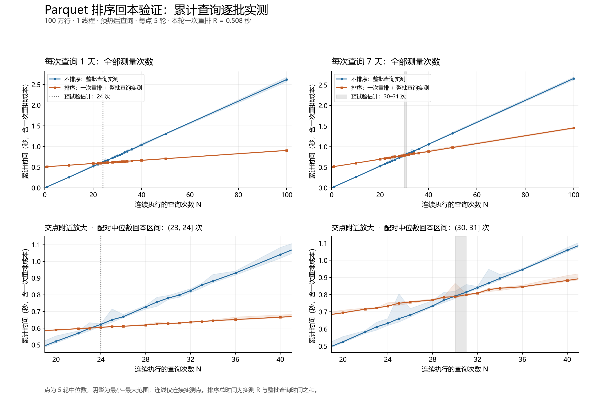

# 模拟海洋观测表的 Parquet 排序收益边界

海洋数据挖掘课程实验项目。以 100 万行模拟海洋观测数据为对象，研究时间排序布局在计入一次重排成本后，能否通过后续查询节省时间，以及查询窗口长度和行组边界如何影响收益。

**[实验论文（PDF，15 页）](模拟海洋观测表的Parquet排序收益边界_正式版.pdf) · [LaTeX 源码](paper/main.tex) · [复现指南](docs/复现指南.md)**

> **AI 协作记录：[AI聊天记录.md](./AI聊天记录.md)**
>
> 文件位于**仓库根目录**，与本 README 同级，保留用户消息、AI 回复及讨论顺序。记录范围和截止位置见文件首部。

作者：陈立冬（22634016）｜课程：海洋数据挖掘｜授课教师：张帆

## 研究问题

Parquet 排序可以改善时间范围查询的数据跳过效果，但排序本身也需要时间。本项目围绕三个问题开展实验：

1. 只比较单次查询速度，会遗漏多少一次性重排成本？
2. 查询一天和查询七天时，累计收益与回本位置有什么区别？
3. 同样查询一天，窗口位于一个行组内或跨越两个行组，收益是否不同？

探索重点是累计成本的实测比较、按元数据选择窗口的配对实验，以及收益适用条件的分析。成本公式、Parquet 数据跳过机制和 10% 评价门槛均不作为本项目提出的新算法。

## 实验设计与主要结果

实验使用同一份模拟观测表的随机布局和时间排序布局，在 DuckDB 2.0.0、单线程、预热条件下执行相同查询序列。每个条件重复五轮，累计查询耗时来自整批实际执行；排序方案的总成本还包含一次重排成本。

主实验的结果如下。表中次数均为**本次已测点**，不能作为其他数据或设备上的通用阈值。

| 查询窗口 | 首次持续满足五轮均有净节省的已测次数 | 首次五轮总耗时均降低至少 10% 的已测次数 |
|---|---:|---:|
| 一天 | 24 | 28 |
| 七天 | 31 | 36 |

24 次和 31 次时的总耗时降幅中位数分别为 2.88% 和 2.45%，按实验标准仍属于“接近打平”。出现净节省与达到 10% 收益是两个不同判断。



看到主实验结果后，补充实验固定一天长度，按元数据选择六对命中记录数接近的组内／跨界窗口。沿用历史重排成本时，两类首次五轮均达到 10% 收益的已测次数分别为 26 和 28。该结果来自另一运行批次，不能与主实验的次数差异直接作因果比较。之后的事后复核分别检查总耗时与查询阶段的预测误差。

完整结果、实验先后顺序和局限性见[正式论文](paper/main.pdf)。数据为模拟数据，结果受硬件、缓存状态、数据布局和查询分布限制；候选行组数不等于实际磁盘读取量。

## 快速开始

阅读论文和结果不需要安装依赖。核查历史结果可使用 Python 3.12，在项目根目录执行：

```powershell
git clone https://github.com/dongzai1952/Homework-Marine-Data-Mining-Technology.git
cd Homework-Marine-Data-Mining-Technology
python tools/reproduce_v2.py verify-history
python paper/tools/build_materials.py verify
```

这两条 Python 命令只使用标准库，检查保存结果的内部一致性、文件哈希和论文数值来源，**不生成数据、不重新计时**。仓库不包含可再生成的 Parquet 大文件，因此核查时提示原始数据 `absent` 属于预期行为。

重新生成数据、绘图或执行性能实验，请按[复现指南](docs/复现指南.md)安装环境并创建独立实验副本。复现入口为 `tools/reproduce_v2.py`；历史脚本可能含原运行目录，不宜直接用于新实验。已验证环境为 Windows x64、Python 3.12.14；其他环境的安装、字体和性能结果尚未验证。

论文采用 `ctexart`、XeLaTeX 和 Biber 排版，编译方法及图表生成说明见 [paper/README.md](paper/README.md)。

## 仓库结构

| 路径 | 内容 |
|---|---|
| [AI聊天记录.md](AI聊天记录.md) | 指定聊天的原始文本导出 |
| [paper/](paper/) | 正式 PDF、LaTeX 源码、参考文献、图表和编译说明 |
| [results/pilot/](results/pilot/) | 两轮预实验记录 |
| [results/formal/formal_20261117_01/](results/formal/formal_20261117_01/) | 主实验配置、测量记录、汇总和图表 |
| [results/supplement/boundary_20261118_01/](results/supplement/boundary_20261118_01/) | 行组边界补充实验的冻结窗口、方法和结果 |
| [results/posthoc/error_metrics_v2/](results/posthoc/error_metrics_v2/) | 总耗时与查询阶段误差的事后复核 |
| [tools/](tools/) | 复现入口与公开文件核查工具 |
| [docs/](docs/) | 实验方法、复现指南及验证记录 |
| [report/](report/) · [archive/](archive/) | 历史报告、图像与原始脚本 |

原始实验记录保留不变；新运行使用独立目录和新的运行 ID。数据、依赖、缓存及复现输出由 `.gitignore` 排除，`.gitattributes` 保留历史文件的换行字节以便核对哈希。

## 材料与记录

- **正式版本**：以 `paper/main.pdf` 及配套源码为准，根目录正式 PDF 为同一文件的副本。
- **AI 协作**：根目录 `AI聊天记录.md` 保留指定聊天的用户／AI原文，不以协作摘要替代。另一聊天及导出截止后的消息不在该文件范围内。
- **复现证据**：[复现验证记录](docs/复现验证记录_v2.md)说明实际验证范围；新接口的完整性能重跑与跨机器复现尚未验证。
- **公开访问**：仓库已公开；核查日期、材料提交号和文件哈希见[提交状态](提交状态.md)。旧报告和日志中的状态描述按形成时记录保留。
