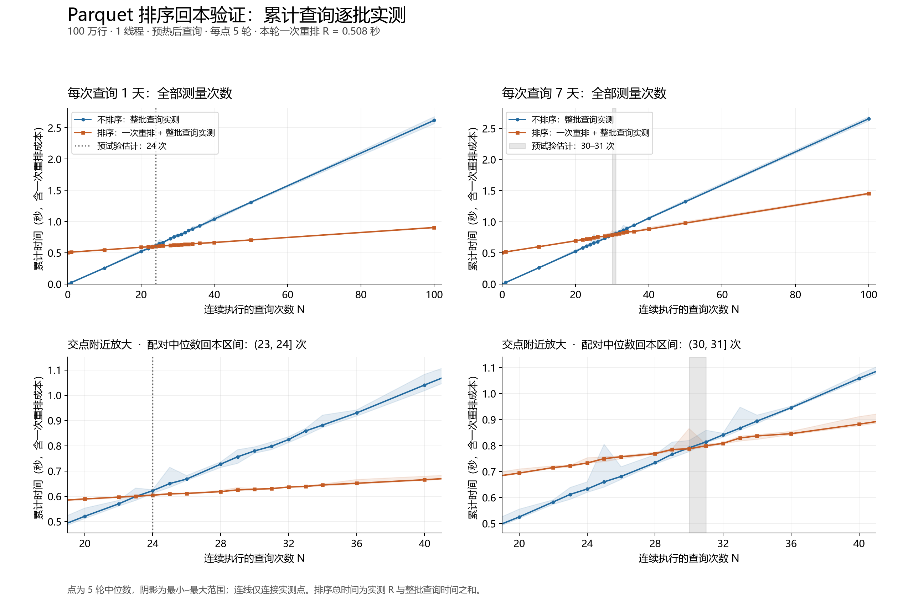
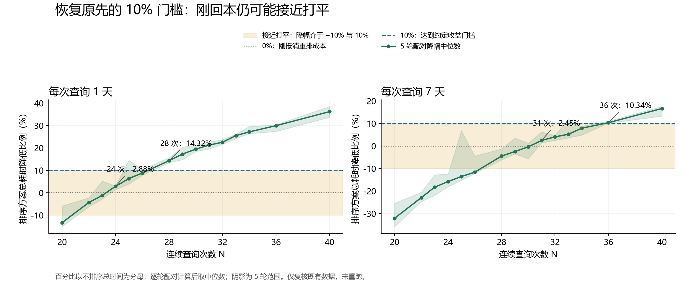
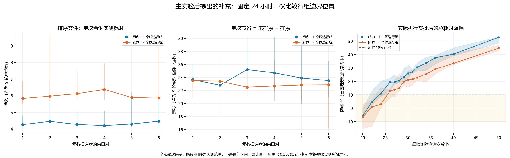

# 模拟海洋观测表的 Parquet 排序收益边界

**一天、七天窗口与行组边界的累计成本实验**

> **公开 GitHub 仓库链接：待填写（尚未创建、尚未上传）。**
>
> **完整 AI 聊天记录 Markdown：待导出、核对并上传；本报告中的协作概述不能替代完整记录。**
>
> 作者／学号／班级：**待填写**。课程：海洋数据挖掘。授课教师与课程资料年份：**待核实**。

版本：第一版完整 Markdown 初稿，2026-11-18。包含已完成的实验及事后复核，不新增实验。文中的“主实验”即前期讨论中的“原实验”。本文件拟放置于仓库的 `report/` 目录；三张图片以 `figures/` 相对路径引用，代码与结果证据链接指向仓库根目录下的相应文件。

## 摘要

本研究围绕模拟海洋观测表的时间范围查询，考察 Parquet 按时间排序后的查询收益在计入一次性重排成本后如何变化。实验使用 100 万行、覆盖 30 天的模拟数据，在 DuckDB 2.0.0、单线程及预热条件下，对同一数据的无序与排序布局进行成对比较，累计耗时通过实际执行整批查询获得。主实验中，在已测次数内，一天与七天窗口首次达到“5 轮均出现净节省，并在后续已测点保持”的位置分别为 24 次和 31 次；此时降幅中位数仅为 2.88% 和 2.45%，按原定标准仍属接近打平。首次 5 轮均达到总耗时降低至少 10% 的已测位置分别为 28 次和 36 次。看到主实验后提出的行组边界补充实验固定一天长度，按元数据选择六对命中行数接近的窗口；在沿用历史排序成本的条件下，组内与跨两个行组的窗口首次 5 轮均达到 10% 的已测位置分别为 26 次和 28 次。两批实验的组内结果也存在差异，不能将跨批次次数变化归因于行组边界。主实验之后、补充实验之前进行的预测误差检查属于事后复核：两份历史预实验参数分别计算的排序方案总耗时预测，对已测次数实测中位数的最大相对误差为 2.19%～7.11%，低于原约定的 20%，但不构成严格预先登记的独立预测验证。本研究的探索在于具体条件下的实验设计、验证与适用范围分析，不提出新算法，也不提供普遍适用的“超过某次数就应排序”的建议。

**关键词：**Parquet；数据布局；时间范围查询；排序成本；累计收益；AI 协作。

## 1. 背景与已有方法

### 1.1 从课程知识点到具体问题

本课题对应《第二章_第3讲_列式布局与AI数据底座》中关于列裁剪、谓词下推、数据跳过及物理排序的内容。课件第 4、5、7、9 张幻灯片分别说明文件结构与范围信息、减少读取的方式、无序数据使范围过宽，以及排序对数据跳过的作用；这里按包含封面的文件页序计数，页脚编号分别为 3、4、6、8。[1]

这些内容提供了研究起点，但并没有给出本数据、本机器或本查询负载下的回本次数。本文将范围限定为一个已有文件上的时间筛选与温度聚合问题，观察排序查询的优势能否覆盖一次性重排成本，以及结论如何随窗口条件变化。“海洋观测”用于限定模拟表的字段与查询场景，不表示本研究已验证真实海洋业务性能。

### 1.2 已有的文件组织与数据跳过机制

Parquet 官方文档将行组定义为按行进行的逻辑划分；一个行组包含各列的列块，列块又由页面组成。因而，行组、列块和页面不是可直接互换的概念，行组数量也不能直接当作操作系统实际读取次数。[Parquet Concepts，文献 2](https://parquet.apache.org/docs/concepts/)

DuckDB 的 Parquet 文档说明，其读取器支持列投影和筛选下推，并可在存在相应范围统计的情况下排除文件中的部分数据。这为本研究以直接时间范围谓词查询 Parquet 提供了已有机制依据，但不证明本实验实际读取了多少字节。[Reading and Writing Parquet Files，文献 3](https://duckdb.org/docs/2.0/data/parquet/overview#partial-reading)

DuckDB 官方技术文章进一步解释，按筛选列组织数据可以使最小值、最大值范围更集中，从而改善选择性查询的数据跳过机会。这是本课题采用排序布局的背景依据，本文没有发明这一机制。该文章主要用 DuckDB 内部文件结构说明原理，不能把其中的默认行组大小或性能示例直接当作本实验参数、结果。[Sorting on Insert for Fast Selective Queries，文献 4](https://www.duckdb.org/2025/05/14/sorting-for-fast-selective-queries)

### 1.3 成本权衡与本次探索的边界

已有研究指出，重组数据布局的成本可能抵消后续查询收益。Rong 等提出的 OReO 框架研究如何在动态负载下权衡查询与重组成本，说明成本权衡本身已是已有研究问题。本文未实现或比较 OReO，不借用其性能数字或理论保证支持本实验结论。[Dynamic Data Layout Optimization with Worst-case Guarantees，文献 5](https://arxiv.org/abs/2405.04984)

| 内容 | 本文中的归属 |
|---|---|
| 列式文件、范围统计、数据跳过、按筛选列排序 | 课程与已有技术 |
| 将重排成本与查询成本合并考虑 | 已有成本权衡思想 |
| 10% 收益门槛、20% 预测误差限值 | 本次约定的评价标准，不是技术创新或统计显著性标准 |
| 一天／七天的累计实测与同一序列成对验证 | 本次具体实验设计与证据 |
| 固定一天、按元数据选窗的边界补充比较 | 主实验后提出并独立冻结的补充探索 |
| 恢复遗漏的 10% 分类、补做误差复核 | 分析纠错与核查，不包装成新方法 |
| 新排序算法、自动选择器或普遍回本阈值 | 本文没有提出或验证 |

### 1.4 实际研究顺序

| 阶段 | 已知时间与顺序 | 对报告解释的约束 |
|---|---|---|
| 两轮预实验 | 主实验之前，在原 C 盘工作目录执行 | 用于规模判断和原先估计；已有 JSON 不含完整起止时间戳 |
| 主实验 | 2026-11-17 22:57:01～23:00:58，+08:00 | 配置先冻结，随后排序、校验、预热和整批计时 |
| 标准与预测误差复核 | 主实验之后、补充实验准备之前；复核 JSON 未记录精确执行时刻 | 用已有数据恢复 10% 分类，并补做 20% 误差检查，不重新计时 |
| 行组边界补充 | 2026-11-18 13:51:37 保存配置；13:51:57 开始计时，13:55:03 完成 | 问题在看到主实验后提出，清单和标准先于本轮性能计时冻结 |
| 方法核对与报告整合 | 两轮实验及复核之后 | 检查代码、记录、文件元数据和引用，不新增性能实验 |

补充实验冻结配置的 `source_files` 包含原实验 `criteria_audit.json` 的哈希，支持“误差复核已在补充实验准备前存在”的顺序判断；不据此补造复核的具体时刻。证据文件见附录 B。

## 2. 研究问题与本次探索

本研究以模拟海洋观测表的时间范围查询为场景，考察 Parquet 文件按时间排序后的查询收益及其适用条件。研究关注的具体问题是：在计入一次性数据重排成本后，查询窗口长度和窗口相对行组边界的位置，如何影响累计耗时与收益判断。本文将“出现净节省”和“总耗时至少降低 10%”分别报告，不把某个观测到的查询次数写成通用排序建议。

已有机制、成本权衡和本次探索的归属见第 1 节。本文不把排序、成本计入或评价门槛本身作为技术创新。

本次探索围绕三个问题展开：

1. 只比较排序前后的单次查询速度，会遗漏哪些成本和收益条件？
2. 在相同数据和运行配置下，查询一天与查询七天，对累计收益有什么影响？
3. 固定查询长度为一天，落在一个行组内与跨越两个行组的窗口，是否会改变单次节省时间及 10% 门槛附近的判断？

原实验采用覆盖 30 天的 100 万行模拟观测数据，对比原始无序文件与按 `event_time, observation_id` 排序的文件。两种布局的记录内容一致，压缩配置均为 ZSTD level 3，目标行组大小均为 65,536 行，查询均按时间区间执行记录数、温度总和与平均值聚合。引擎固定为 DuckDB 2.0.0、单线程、1GB 内存上限。原实验在同一运行批次中比较一天与七天窗口；相同次数和轮次使用对应的查询起点序列，两种布局执行完全相同的查询。每个累计查询次数重复 5 轮，实际执行整批查询并计时，没有用单次平均耗时乘次数充当累计实测结果。[证据 A]

第三个问题是在看到原实验结果、发现原实验的一天窗口均只涉及一个候选行组后提出的，属于主实验之后的补充探索。补充实验独立保存，在计时前冻结窗口清单、运行顺序和判断标准。每类选择 6 个窗口：组内窗口以选定行组的时间范围中点为中心，跨界窗口以下一行组的起始时间为中心，均覆盖连续 24 小时。窗口完全按元数据定位，不按测速结果筛选；每对命中记录数差异为 0.03%～1.49%，通过预先设定的不超过 3% 的检查。单次查询每窗口重复 9 轮，整批查询每个次数重复 5 轮。[证据 C]

本次工作的独立探索体现在具体问题的细化、成对计时与结果一致性验证、净节省和实用收益的区分，以及对窗口边界和运行批次适用条件的检查。它提供的是一个可复核的案例及其边界分析，不主张发明新的排序算法，也不声称实现了能够自动判断何时排序的选择器。


## 3. 数据与实验方法

本节以项目中的实际脚本、冻结配置、逐组运行日志及结果文件为依据。主实验指 `formal_20261117_01`，补充实验指 `boundary_20261118_01`；预实验只用于说明数据来源、规模选择与先前估计。本次撰写仅检查代码、已有记录和 Parquet 文件尾部元数据，没有重新生成数据或开展性能计时。

### 3.1 模拟数据的来源与生成方法

#### 3.1.1 数据来源与可追溯性

100 万行原始数据由预实验脚本生成。两份历史预实验记录中的脚本 SHA256 均与归档脚本 `archive\pilot_parquet_original.py` 相符。当前项目根目录的 `pilot_parquet.py` 调整了目录定位，生成公式与归档版相同，但历史记录对应的是归档脚本，不能把当前脚本的哈希冒充历史哈希。

主实验没有重新生成原始数据，而是读取整理到项目中的 `data\pilot\1000000\random.parquet`，重新进行三次完整排序写出。补充实验使用这一原始文件和主实验的排序文件，不重新生成数据或排序。本次核对确认，两文件 SHA256 与主实验及补充实验记录相符。

生成方法不是调用 Python 随机数生成器逐行抽样，而是对行号、固定常量和字段标签计算 DuckDB 哈希，再取模：

```sql
SELECT
  i::BIGINT AS observation_id,
  TIMESTAMP '2026-06-01'
    + (hash(i, 1729, 'time') % 2592000)::BIGINT
      * INTERVAL '1 second' AS event_time,
  (hash(i, 1729, 'station') % 1000)::INTEGER AS station_id,
  (10000000 + hash(i, 1729, 'lat') % 35000001)::INTEGER
    AS latitude_microdeg,
  (110000000 + hash(i, 1729, 'lon') % 30000001)::INTEGER
    AS longitude_microdeg,
  (500 + hash(i, 1729, 'temp') % 2501)::INTEGER
    AS temperature_centi_c
FROM range(1000000) AS t(i);
```

`1729` 是数据生成所用的固定哈希输入常量，历史 JSON 将其记为 `seed`；它不是 `random.seed(1729)` 或 DuckDB 的 `SETSEED` 调用。不同字段使用不同标签进行区分，代码没有主动构造字段之间的物理关系，也没有检验它们是否严格统计独立。复现应同时固定代码和引擎版本；不同版本下能否得到完全相同字节的数据文件，未进行验证。

#### 3.1.2 字段、单位与分布

| 字段 | SQL 类型 | 生成范围和含义 |
|---|---|---|
| `observation_id` | BIGINT | 0～999,999 的唯一行号，不是时间排序号 |
| `event_time` | TIMESTAMP | 以 2026-06-01 00:00:00 为起点，增加 0～2,591,999 秒；覆盖 30 天，生成分辨率为 1 秒 |
| `station_id` | INTEGER | 0～999 的站点编号 |
| `latitude_microdeg` | INTEGER | 10,000,000～45,000,000；除以 1,000,000 转为纬度，即 10°～45°N |
| `longitude_microdeg` | INTEGER | 110,000,000～140,000,000；除以 1,000,000 转为经度，即 110°～140°E |
| `temperature_centi_c` | INTEGER | 500～3,000；除以 100 转为摄氏度，即 5.00～30.00 ℃，步长 0.01 ℃ |

时间和温度均按哈希取模产生，意图构造近似均匀的离散覆盖。这里的“近似均匀”描述生成方式，不表示每秒、每天或每个温度值出现次数完全相同，也不是已通过均匀性检验的结论。温度没有采用正态分布、季节曲线或随纬度变化的模型。若按理想离散均匀分布计算，其温度中心值为 17.5 ℃；这不是本次保存的全表实测均值。

历史实验未保存全表温度频数表、时间直方图或均匀性检验。本次仅查看文件尾部统计，确认实际时间最小值为 **2026-06-01 00:00:01**，最大值为 **2026-06-30 23:59:59**；温度最小值为 **500**、最大值为 **3,000**；六列的空值计数均为 0。生成公式允许的时间起点与实际样本最小值并不完全相同。Parquet 将时间以微秒单位存储，但本数据生成时只使用整秒；该时间列不带时区，不能将它解释为已经校准的 UTC 观测时间。

原文件按生成行号写出，时间相对行号为伪随机分布。“无序布局”指没有按查询时间列排序，不表示对整张表额外执行了随机洗牌。排序布局使用 `ORDER BY event_time, observation_id`，第二个键用于确定相同时间下的顺序。

#### 3.1.3 体现的观测表特点与简化

数据保留了观测记录编号、时间、站点、位置和测量值这类表结构，允许以时间范围进行记录数和温度聚合，并可检查不同物理布局是否返回一致结果。同一秒可以有多条记录，原始行序也不按时间排列，适合研究时间筛选与列式布局之间的关系。

但它只是采用观测表字段的模拟数据，不是真实海洋观测过程模型：站点编号没有绑定固定位置；经纬度在矩形范围内生成，未做海陆掩膜，部分坐标可能落在陆地；温度与时间、经纬度及站点之间没有设定季节变化、空间梯度或传感器特性。数据没有缺测、质量标记、深度、盐度、异常事件、采样频率变化或观测编号重复。原始行序未按时间排序，也不等于模拟了具有到达时间和延迟机制的真实迟到数据。本次查询只使用时间和温度列，没有进行空间查询或验证站点—坐标关系。

### 3.2 环境、文件布局与随机性控制

| 项目 | 核对结果 | 证据性质 |
|---|---|---|
| Python | 3.12.14 | 两轮预实验、主实验、补充实验运行记录一致 |
| DuckDB | 2.0.0 | 各运行记录一致；当前本地依赖也为此版本 |
| 操作系统标识 | `Windows-10-10.0.19045-SP0` | 各运行记录中的 `platform` |
| 查询线程与内存配置 | `threads=1`，`memory_limit='1GB'` | 实际代码及冻结配置；1GB 是引擎设置，不是机器物理内存容量 |
| 行序保留设置 | `preserve_insertion_order=true` | 实际代码 |
| 文件格式 | Parquet，每种布局一个文件 | 写出代码与现存文件 |
| 压缩 | ZSTD，写出配置 level 3 | ZSTD 已由文件元数据核对；level 3 依据代码和运行记录，文件元数据未直接给出该级别 |
| 目标行组大小 | 65,536 行 | `ROW_GROUP_SIZE 65536` |
| 实际行组 | 16 组：前 15 组各 65,536 行，末组 16,960 行 | 历史元数据与本次文件尾部检查一致 |
| 未排序／排序文件大小 | 16,665,663／16,027,428 字节 | 主实验记录与现存文件一致 |
| Matplotlib／NumPy | 3.11.2／2.5.5 | `requirements.txt` 与当前 `.deps` 安装版本一致；历史计时配置未记录这两个绘图库版本，不能据当前安装证明过去每次出图版本 |
| CPU 与硬件信息 | 主实验记录逻辑 CPU 数为 12 | 未保存 CPU 型号、物理内存、磁盘型号、温度、频率或背景负载；补充配置未再次记录 CPU 数 |

实际使用的本机解释器路径为 `C:\Users\Administrator\.cache\codex-runtimes\codex-primary-runtime\dependencies\python\python.exe`。主实验、绘图和补充脚本优先读取项目的 `.deps`；当前 `pilot_parquet.py` 不会自动加入 `.deps`，运行它需通过环境路径或已安装依赖的解释器提供 DuckDB。预实验原先在 C 盘目录运行，整理后主实验与补充实验使用 E 盘文件；记录不足以证明两个盘符对应不同物理设备。

随机性控制分为不同用途，不应合写成一个种子：

| 用途 | 固定值 | 实际使用方式 |
|---|---:|---|
| 数据生成 | 1729 | 哈希输入常量 |
| 预实验查询调度 | 20261117 | `random.Random` 打乱窗口类别及每批查询索引 |
| 预实验 bootstrap | 42 | 对 9 个配对批次的平均每查询差值进行 5,000 次重采样；只用于预实验诊断 |
| 主实验查询调度 | 2026111701 | 生成查询序列与每轮条件顺序 |
| 补充实验查询调度 | 2026111801 | 生成单次窗口顺序、整批序列及条件顺序 |

### 3.3 数据准备与预实验的实际顺序

两份预实验记录分别对应一次独立脚本运行。每次先生成并写出 100 万行原始文件，再连续进行三次读取、排序和写出；之后检查两文件的总行数、唯一观测编号数及按编号全外连接的逐字段差异，读取行组元数据，并检查一天、七天两类查询的结果一致性。

预实验起点是相对 2026-06-01 的 `[0,4,8,12,16,20,23]` 天，均从午夜开始。正确性检查后，先将两类长度、两种布局、七个起点的全部组合执行两遍作为显式预热，再进行 9 轮计时。每轮打乱一天与七天的先后顺序；对每类长度，将七个查询各重复五次得到 35 条查询，再打乱顺序，两种布局共用该顺序。布局先后按轮次交替。

预实验的“每查询耗时”是实际 35 条查询整批耗时除以 35，不是对每条查询分别计时。预实验脚本只在计时前核对各窗口结果，没有像主实验那样保存并逐条复核每次已计时的返回值。数据生成耗时记录在 `generation_s_excluded`，未计入回本成本。两次预实验得到的估算只用于确定主实验关注范围，不能替代主实验的累计实测。

### 3.4 主实验的实际执行顺序

主实验配置于 **2026-11-17 22:57:01（+08:00）** 保存，运行记录结束于 **23:00:58**。流程如下。

1. **读取输入并冻结配置。**计算现有原始文件 SHA256，读取两份预实验结果及其哈希，生成查询序列和运行顺序，将其连同软件版本、成本口径及零收益交点规则写入 `config_frozen.json`。计算输入哈希本身会读取文件，故后续排序成本不能称为严格冷缓存测量。
2. **连接和设置。**创建一个 DuckDB 连接，设置单线程、1GB 内存上限、保留插入顺序，并将临时目录指向本次主实验数据目录下的 `temp`。连接和设置不计入查询或排序耗时。
3. **测量重排成本。**同一连接连续执行三次完整 `COPY (SELECT * FROM read_parquet(...) ORDER BY event_time, observation_id)`，均写到本次运行的排序文件，后一次替换前一次输出。每次使用 `perf_counter_ns` 围住整个 COPY 调用。三次分别为 0.5079524、0.5097535、0.4942601 秒，取中位数 **0.5079524 秒**作为一次重排成本 R，而不是把三次之和记作一次成本。没有在三次之间清缓存，也没有另行执行强制持久化操作。
4. **全表正确性检查。**建立两布局视图，各检查总行数和 `observation_id` 去重数均为 1,000,000；按编号全外连接，逐字段检查缺失或不同，差异数为 0；读取并核对两布局各行组的行数。该检查发生在排序之后、查询计时之前。
5. **建立查询与参考答案。**使用偏移 `[2,6,10,14,18,22]` 天，即 6 月 3、7、11、15、19、23 日午夜作为起点，各查一天和七天。分别在两布局运行 12 个窗口，检查 `count`、整数 `sum` 完全一致，平均值按 `math.isclose(rel_tol=1e-12, abs_tol=1e-10)` 比较，保存参考答案与候选行组信息。这些查询不计入性能测量。
6. **按冻结顺序预热并计时。**每轮先把六个起点打乱成一个块，继续生成这样的块，拼接并截取前 100 个起点。不同查询次数 N 使用同一轮序列的前 N 项，所以完整六项块内均衡，但任意前缀不保证六个窗口出现次数完全相同。一天、七天和两种布局使用对应的起点序列。每轮将所有“窗口长度×查询次数”条件打乱；布局先后由轮次、N 在列表中的索引及窗口类别的奇偶规则决定，并非始终先测未排序。
7. **每个条件先预热两布局，再分别测整批。**按该条件的布局顺序，先在每种布局上把当前长度的六个窗口各执行一次；两种布局都预热完后，再依次开始两布局整批计时。每批实际执行 N 次 `execute(...).fetchone()`，保留返回结果，结束计时后逐条与参考答案比较。暖场查询与结果验证均在计时器外。不是逐条交替执行未排序与排序查询，而是先完整执行一种布局的 N 条，再执行另一种布局。
8. **保存全部轮次并复核输入。**每个配对批次写入日志，完成后再次计算原始文件哈希，确认未变，保存 `measurements.json`。记录中共 190 个配对批次、11,880 次已计时查询，全部主实验计时结果通过参考答案检查。日志中的整段实验历时还包含预热、检查和写日志等开销，不用作某方案的累计成本。

主实验的 N 为：`[1,10,20,22,23,24,25,26,28,29,30,31,32,33,34,36,40,50,100]`，每个长度、每个 N 重复 5 轮。共有 `19×2×5=190` 个配对批次。较大的 N 会从头重新执行完整前缀，不是把同一条长运行切成多个累计点。

查询模板如下，其中区间左闭右开；时间字段不做日期截断：

```sql
SELECT count(*),
       sum(temperature_centi_c),
       avg(temperature_centi_c)/100.0
FROM raw_data  -- 或 sorted_data
WHERE event_time >= TIMESTAMP '起点'
  AND event_time <  TIMESTAMP '终点';
```

`sum` 保留整数百分之一摄氏度的数值单位；只有平均值除以 100 转为摄氏度。筛选和聚合只涉及时间、温度及记录计数，不查询站点和经纬度。

主实验运行后，`plot_formal.py` 从已有记录生成累计图和零收益交点汇总，并使用三次不同 R 做过零收益交点敏感性分析。10% 分类与 20% 预测误差是在后续 `audit_criteria.py` 中基于保留数据补做的。10% 虽来自先前约定，但没有完整写进主实验冻结配置；不能将该复核说成首次正式分析已经完成的预登记检验。

### 3.5 补充实验的实际执行顺序

补充问题在看到主实验结果之后提出。脚本分为 `prepare`、`run` 和 `analyze` 三个阶段，实际按此顺序执行。

#### 3.5.1 prepare：先核对与选窗，再冻结

首先新建独立结果目录；已有目录时拒绝覆盖。核对原始文件、主实验排序文件的哈希，读取两文件的行组元数据并与主实验记录比较。补充阶段没有重新执行全表全外连接，而是用文件哈希相同继承主实验的全表等价验证。

固定选取排序文件的零起算行组编号 `[1,3,5,7,9,11]`。组内窗口以该行组时间最小值、最大值的中点为中心，中点截到整秒；跨界窗口以下一行组的最小时间为中心。两者均向前、后各取 12 小时。根据 `[起点,终点)` 与各组时间范围是否重叠，核对组内恰有一个候选行组、跨界恰有两个，未排序文件均有 16 个。候选数不是实测磁盘读取量。

随后对 12 个窗口分别查询两布局，检查结果一致并保存参考答案；对每对窗口检查：

$$
命中行数差异率=\frac{|n_{组内}-n_{跨界}|}{(n_{组内}+n_{跨界})/2}\times100\%\le3\%.
$$

六对实际差异为 0.03%～1.49%，未触发停止条件，没有因性能筛选或替换窗口。这里先做了不计时的参考答案与行数检查，之后才冻结清单，因此“先冻结”准确指**先于性能计时**，并非在任何 SQL 查询之前。

随后生成单次查询及整批查询顺序，保存 `windows_frozen.json`、`config_frozen.json`、`protocol_frozen.md` 与哈希清单。配置保存时间为 **2026-11-18 13:51:37（+08:00）**，性能计时开始记录为 **13:51:57**。冻结规则明确沿用历史 R=0.5079524 秒，保留所有轮次，分别检查中位数达标、5 轮全部达标及后续已测次数是否持续达标。

#### 3.5.2 run：先逐窗口单次计时，再做整批计时

开始前核对脚本、冻结文件和来源文件哈希；若已有 `events.jsonl`，拒绝再次计时覆盖。新建连接并创建视图，使用单线程、1GB 内存上限、保留插入顺序。补充脚本没有像主实验那样显式设置临时目录，也未记录最终生效的默认临时目录；因此应写“主要查询设置相同”，不写“所有引擎设置逐项完全相同”。

**单次阶段：**每轮随机打乱六对窗口的顺序，再按轮次与窗口编号交替组内、跨界的先后；两布局先后也按冻结奇偶规则交替。每个窗口计时前，先在两布局各执行一次该窗口预热，再分别测一次查询并在计时后核对参考答案。12 个窗口各 9 轮，共 108 个配对、216 次计时查询。这里是真正的单次计时，与预实验“整批耗时除以查询数”的指标不同。

**整批阶段：**每轮将六个窗口对编号按打乱的六项块拼接，截取前 50 项；两类窗口共用编号序列，但映射为各自的具体时间窗口。每轮随机排列 N，并交替两类窗口的先后；两布局使用完全相同的具体查询序列。每个类别与 N 的配对计时前，在两布局分别运行本类别的六个窗口进行预热；之后逐布局实际执行 N 条，计时结束后核对全部返回值。

补充 N 为 `[20,22,24,26,27,28,29,30,31,32,34,36,40,50]`，每类、每个 N 共 5 轮。整批阶段有 `14×2×5=140` 个配对、8,580 次计时查询；加上单次阶段，共 **8,796 次**。预热与准备查询不计入这个次数。最后复核来源文件哈希，保存全部测量；完成时间为 **13:55:03**。所有主实验和补充实验的已计时返回值均通过结果检查。

#### 3.5.3 analyze：只处理已保存的计时结果

单次结果先按窗口汇总 9 轮的配对节省，再汇总六个窗口中位数；另保留各窗口对逐轮“组内节省减跨界节省”的差值。整批结果逐轮计算含固定历史 R 的降幅，再汇总中位数、范围和达标轮数。该阶段只读取 JSON 并作图，不执行数据查询、重排或性能计时，但会更新本轮派生汇总、图片和产物清单。

### 3.6 计时与成本边界

| 操作或开销 | 是否计入方案累计成本 | 实际处理 |
|---|---|---|
| 初始生成无序数据 | 否 | 预实验另有耗时记录；本研究比较从原始 Parquet 已存在开始 |
| 主实验读取、排序、压缩并写出 | 是，作为一次 R | 三次测量取中位数，不累加三次；COPY 返回即结束 |
| 补充实验重排 | 没有重新执行 | 沿用历史 R |
| 每批 N 次查询执行与取回聚合结果 | 是 | 围住实际整批执行的计时器；包括调用路径内的引擎工作以及 Python 循环、结果列表追加等开销 |
| SQL 列表准备、连接、建视图及参数设置 | 否 | 查询计时器外；不能把它们加入当前累计结果而仍称原实测口径 |
| 参考答案、全表检查、元数据读取、哈希检查 | 否 | 准备阶段或计时器外执行；这些读取也可能影响缓存状态 |
| 显式预热 | 否 | 每个测量配对之前执行，无清缓存操作 |
| 逐条正确性复核、日志与图表输出 | 否 | 计时器外执行 |
| 操作系统调度、缓存命中、执行期间发生的干扰 | 随经过时间计入，未分解 | 未记录 CPU 时间、物理 I/O 字节或后台进程状态，不能归因到具体原因 |

累计成本按 `T_u` 与 `R+T_s` 比较，是分段实测量的加和，不是包含生成、预热、核对等全部流程的一条连续秒表。没有进行冷缓存或持久化写入保证的实验，也没有将长期增量维护成本纳入。5 轮范围是描述性最小值—最大值，不是置信区间；预实验的 bootstrap 区间不能替代主实验或补充实验的不确定性分析。


## 4. 结果分析与局限


下文将原实验与补充实验分开分析。设同一轮未排序布局的整批耗时为 $T_u$，排序布局的整批查询耗时为 $T_s$，一次性重排成本为 $R$，则净节省为 $T_u-(R+T_s)$，总耗时降幅为：

$$
p=\frac{T_u-(R+T_s)}{T_u}\times100\%.
$$

百分比先逐轮计算，再汇总 5 轮的中位数、范围及达标轮数。$p>0$ 表示观察到净节省；$-10\%<p<10\%$ 归为接近打平；$p\ge10\%$ 表示达到本次约定的收益门槛。分别取中位数后的时间相减或相除，不一定等于逐轮配对结果的中位数，本文的判断以后者为准。文中主实验“开始净节省”的位置采用“首次 5 轮均为正、且在后续已测点保持”的判据，不等于首次有任意一轮为正。既有复核记录显示，一天与七天窗口首次出现个别轮次正收益的已测次数分别为 23 次和 25 次；持续的 5 轮正收益位置则分别为 24 次和 31 次。[证据 B]

### 4.1 只看单次查询速度会漏掉什么？

**原实验表明，单次查询变快并不等于包含重排成本的整体方案立即更快。**在一天窗口、每批只执行一次查询的原实验记录中，未排序查询耗时中位数为 25.456 毫秒，排序后查询为 4.294 毫秒。单看查询阶段，排序布局明显更快。但三次完整“读取原文件—排序—写出文件”实测成本的中位数为 0.5079524 秒；加入这一成本后，排序方案的总耗时中位数为 0.512247 秒，明显高于未排序查询的 0.025456 秒。这里的总耗时是两段实测时间相加，不是一次连续端到端计时。[图 1；证据 A]



单次速度也无法区分“刚刚覆盖成本”与“达到约定收益门槛”。原实验在一天窗口的 24 次查询和七天窗口的 31 次查询处，均已观察到 5 轮净节省为正，且在后续已测次数保持为正，但降幅仍不足 10%。

| 原实验条件 | 查询次数 | 成对净节省中位数 | 降幅中位数 | 按原定标准分类 |
|---|---:|---:|---:|---|
| 一天窗口 | 24 | 17.89 毫秒 | 2.88% | 接近打平 |
| 七天窗口 | 31 | 20.12 毫秒 | 2.45% | 接近打平 |

原实验最初的结果整理侧重零收益交点，遗漏了“接近打平”标签。后续使用保留的原始数据恢复原先约定的 10% 分类，没有重跑或修改实测数据。这一修正属于分析口径的复核，不能把早先的零收益交点改写成已达到明显收益的证据。[图 2；证据 B]



### 4.2 查一天和查七天有什么区别？

这一比较来自**原实验同一运行批次**。两类查询使用同一数据、布局、排序成本和运行配置，并采用对应的起点序列，主要改变查询窗口长度。以下整批耗时均来自实际执行 100 次查询后的 5 轮中位数，不是单次耗时外推。

| 原实验指标 | 一天窗口 | 七天窗口 |
|---|---:|---:|
| 未排序：100 次整批查询耗时 | 2.620 秒 | 2.656 秒 |
| 排序后：100 次整批查询耗时，不含重排 | 0.397 秒 | 0.947 秒 |
| 排序方案总耗时，含重排 | 0.905 秒 | 1.455 秒 |
| 首次观察到持续的 5 轮净节省均为正的已测次数 | 24 次 | 31 次 |
| 首次 5 轮总耗时均降低至少 10% 的已测次数 | 28 次 | 36 次 |

七天窗口下，未排序整批耗时与一天窗口接近，而排序后的查询耗时更长。因此，在本次数据和查询设置下，七天窗口获得的查询阶段节省较少，达到累计收益门槛需要更多已测查询次数。同样执行 28 次时，一天窗口的降幅中位数为 14.32%，七天窗口为 −4.49%，分别属于“达到 10%”与“接近打平”。这说明“查询次数相同”不足以保证收益判断相同。[图 1、图 2；证据 A、B]

元数据为这一现象提供了一个相符的解释：原实验选取的六个一天窗口，在排序文件中各有 1 个无法排除的候选行组；七天窗口各有 4 个；未排序文件两类窗口均有 16 个候选行组。但这里统计的是根据时间最小值、最大值推断的候选范围，并未测量实际磁盘读了几个行组或多少字节。窗口变长同时增加命中记录数，查询还涉及解码、过滤和聚合等工作；排序也可能改变压缩效果。因此，这些数据支持“窗口长度与候选范围、查询收益共同变化”的观察，尚不能把候选行组数认定为耗时差异的唯一原因。[证据 A 中的 `preparation.json`、`diagnostics.json`]

上述次数只表示已测点上的位置。原实验未测 27 次和 35 次，不能据此给出精确的最小整数门槛，也不能推导出普遍适用的“超过某次数就应该排序”。

### 4.3 同样查一天，窗口是否跨行组又有什么影响？

这一问题使用**单独运行的补充实验**回答。组内与跨界两类窗口在补充实验同一批次中交替比较，固定 24 小时长度、原有文件、查询形式，以及已核对的单线程、1GB 内存上限和保留插入顺序设置；累计成本仍使用原实验的历史重排成本 0.5079524 秒。补充脚本没有像主实验那样显式设置临时目录，其生效的默认目录未保存，不能将两轮描述为所有引擎设置逐项完全相同。这样做用于比较固定成本下的窗口差异，并没有重新测量补充实验当天的排序成本。[证据 C]

| 补充实验单次指标 | 组内：1 个候选行组 | 跨界：2 个候选行组 |
|---|---:|---:|
| 排序文件查询耗时 | 4.28 毫秒 | 5.93 毫秒 |
| 相对未排序查询的节省 | 23.79 毫秒 | 22.87 毫秒 |

表中对每个窗口的 9 轮结果先取中位数，再汇总六个窗口；节省时间使用逐轮配对差值。六对窗口中，跨界窗口的排序查询耗时中位数均更高，支持在这些样本中存在边界相关开销的观察。不过，净节省还受未排序查询耗时波动影响，并非每一轮跨界窗口都少省时间；图 3 保留了所有轮次的范围。[图 3；证据 C]



整批计时显示，边界附近的收益判断也会不同：

| 每批查询次数 | 组内：降幅中位数 | 组内：达到 10% 的轮数 | 跨界：降幅中位数 | 跨界：达到 10% 的轮数 |
|---|---:|---:|---:|---:|
| 24 | 10.93% | 4/5 | 2.95% | 1/5 |
| 26 | 19.48% | 5/5 | 12.78% | 3/5 |
| 27 | 19.55% | 5/5 | 14.00% | 3/5 |
| 28 | 20.79% | 5/5 | 14.89% | 5/5 |

按中位数判断，两类首次已测达标次数分别为 24 次和 26 次；若要求 5 轮全部达到 10%，分别为 26 次和 28 次，且后续已测次数均保持达标。在 24 次处，两类中位数分类不同，但不是所有轮次都支持这种区分；在 26 次处，两类中位数都已达标，差别在于是否每轮均达标。这些现象应分别表述，不能合并为确定不变的“两次查询差距”。补充实验也未测 25 次。[证据 C 中的 `measurements.json`、`summary.json`]

**原实验与补充实验之间的变化不能直接归因于行组边界。**原实验的一天窗口均为单候选行组，5 轮全部达到 10% 的首次已测位置为 28 次；补充实验组内窗口的相应位置为 26 次。即使同属单候选行组，位置仍发生变化。以 28 次查询为例，未排序整批耗时中位数由原实验的 0.727323 秒变为补充实验组内的 0.802571 秒；排序后的整批查询耗时也由 0.110614 秒变为 0.125904 秒。两次运行的窗口集合和运行批次均不同，不能将这些变化解释为某一个因素的独立效果；CPU 调度或后台负载等可能影响因素未被测量，也不能断言它们就是原因。[证据 A、C]

因此，本节讨论的边界效应依据是补充实验内部的组内—跨界比较。它支持“查询同样长时，起点相对行组的位置也值得纳入收益分析”，但不能证明候选行组增加是唯一因果机制。两类窗口日期不同、命中记录数接近而非完全相等，而且没有直接采集物理 I/O 或各执行阶段开销，这些限制仍然存在。

### 4.4 适用范围与尚未解决的问题

- **数据与环境有限。**实验只覆盖以固定哈希输入常量 1729 生成的一份 100 万行模拟数据、约 16 MB 的单文件布局，以及一台机器上的固定引擎、线程数、压缩与行组设置；查询顺序另用固定调度种子。模拟字段没有构造时间或空间相关关系、缺测及异常事件机制，站点编号未绑定固定位置，经纬度未做海陆筛选，不能直接外推至真实海洋业务或更大数据规模。
- **结论针对预热后的重复查询。**各组计时前显式预热，未清空操作系统缓存；预热、连接初始化和结果核对不计入查询时间。计时包含执行与取回聚合结果，不能当作冷启动、冷缓存或远程对象存储性能。主实验和补充实验的所有已计时查询均与各自窗口的参考答案核对；预实验只在计时前检查窗口答案，不包括逐次计时返回值复核。这保证本次比较查询语义一致，不证明时间表现可跨环境复现。[证据 A、C]
- **成本边界有限。**原实验重排成本取三次实测中位数，并在累计比较中固定使用。虽然另用三个实测 R 做过零收益交点敏感性检查，主体累计结果及 10% 分类并未进行完整的成本不确定性传播。写出计时截至 COPY 返回，不保证数据已持久化到物理介质；补充实验继续使用历史成本。未纳入长期新增数据维护、增量重排或实际业务服务链路的全部成本。
- **次数与重复轮次有限。**“首次”仅指已测次数中的首次；图中的最小—最大范围是描述性范围，不是置信区间，5 轮全部达标也不是未来运行保证。原实验验证窗口虽不同于预实验窗口，但仍来自同一模拟数据，部分时间范围重叠；补充实验也是同一数据上的后续分析，不是独立数据集验证。
- **补充实验和预测误差复核的时间顺序需要保留。**行组边界问题是在看到主实验结果后提出，但补充窗口和判断规则在其计时之前冻结。原先约定的“预测总耗时相对误差不超过 20%”则未在初次正式分析中执行；后续才使用保留的两份预实验参数分别补做复核，没有用正式结果拟合预测。四种“预实验来源×窗口长度”组合中，对各查询次数实测总耗时中位数的最大相对误差为 2.19%～7.11%，均低于 20%；但当时没有预先保存逐次数预测表，也未锁定唯一的主预测来源，因此只能称为事后补充复核，不能写成严格预先登记的预测验证或自动决策能力。[证据 B 中的 `forecast_review`]

## 5. AI 协作过程与贡献说明

本节根据当前对话和保留的代码、运行记录整理，属于协作概述，不是完整聊天记录。学生尚未完成对全部 Markdown 聊天导出的核对，公开仓库尚未创建。不能据此声称完整 AI 过程材料已经提交。

| 环节 | 对话中可确认的学生选择、要求或质疑 | AI 提议及执行工作 | 可核对材料 |
|---|---|---|---|
| 范围收敛 | 要求两天内可完成，明确只做回本点，不做自动选择器 | 协助细化排序收益与成本比较，编写预实验程序 | 对话；预实验脚本和 JSON |
| 窗口长度 | 学生提出将查一天与查七天进行比较 | 将其落实为受控查询条件、序列与结果核对 | 主实验冻结配置 |
| 累计验证 | 学生指出估算次数尚未实际验证，要求整批执行、重复测量、两布局相同查询序列，验证查询不参与原估计 | Codex 编写并通过本机工具运行主实验，记录实际批次时间、校验返回值、生成图表 | `events.jsonl`、`measurements.json` |
| 评价口径纠错 | 学生指出 24 次、31 次的微小节省仍应按原约定归为接近打平，要求检查预测误差且不得倒推预测 | AI 承认初次整理遗漏分类及误差检查，读取原数据复核，保留历史估计和全部结果 | `audit_criteria.py`、`criteria_audit.json` |
| 原创性与边界 | 学生要求区分已有方法与本次探索，不能把成本或 10% 门槛包装成发明 | AI 指出主实验一天窗口全部为一个候选行组，并建议检查窗口边界 | 对话；主实验元数据及诊断 |
| 补充实验约束 | 学生限定只补一个因素，要求按元数据选窗、命中数接近、先保存清单和标准，接受差异很小的结果 | Codex 具体选择六对窗口、冻结规则、执行单次及整批计时，保留全部轮次 | 补充实验清单、配置与原始计时 |
| 报告表达 | 学生拒绝通用次数建议，要求主补实验分开、核实方法和引用、不增加未经验证观点 | AI 核对脚本和来源、整合章节并起草摘要与结论；待学生理解、核对和修订 | 方法核对记录、章节版本与本初稿 |

代码编写、通过工具执行实验、绘图和文字初稿均由 Codex 协助完成；学生对研究范围、验证要求、错误纠正与表达边界作出了明确决定。现有记录不支持写成“学生独立手写全部代码、亲自手动测量全部时间”，也不支持把学生提出的验证要求全归给 AI。方法与结果的可核查依据是实际文件和日志，不是 AI 的解释本身。最终提交前，学生仍需逐项确认自己能解释实验、公式与局限；该确认尚未完成。

## 6. 结论

本研究在一份 100 万行模拟数据、固定 DuckDB 配置和预热查询条件下，完成了布局排序收益的累计成本验证，并通过主实验之后提出的补充比较检查一天窗口的行组边界位置。所有以下次数均限定为本次条件下的已测点，不能解释为普遍或精确的最小整数门槛。

第一，排序后查询更快不能替代含重排成本的累计比较。主实验的一天与七天窗口，首次满足“5 轮均出现净节省并在后续已测点保持”的位置分别为 **24 次、31 次**，但对应降幅中位数仅为 **2.88%、2.45%**，仍属接近打平。按 **5 轮均至少降低总耗时 10%** 的标准，首次已测达标位置分别为 **28 次、36 次**。这是两种不同判据；较早个别轮次出现正收益不等于持续覆盖成本。

第二，同批主实验中，七天窗口排序后的查询耗时高于一天窗口，累计收益门槛也出现在更大的已测次数处。元数据候选行组数与这一现象相符，但命中记录数、解码及聚合等工作同时变化，本研究没有证明候选行组数量是唯一原因，更没有将其测成实际磁盘读取量。

第三，在同批补充实验内部，固定一天长度时，跨界窗口的排序查询耗时中位数更高。沿用历史 R 的条件下，组内与跨界窗口按中位数判断首次达到 10% 的已测位置分别为 **24 次、26 次**；要求 5 轮全部达标时分别为 **26 次、28 次**。但原实验的单候选行组窗口与补充实验组内窗口之间也存在计时差异，因此不能用跨批次次数变化证明边界因素的独立作用。

第四，主实验之后、补充实验之前补做的预测误差复核，使用两份历史预实验参数分别计算预测排序总耗时；四种“参数来源×窗口长度”组合对各已测次数实测中位数的最大相对误差为 **2.19%～7.11%**，均低于原约定 **20%**。当时未预先保存逐次数预测表，也未锁定唯一主预测来源，故这一结果仅支持事后一致性检查，不构成已经验证的通用预测器。

本次探索的价值在于把已有排序与成本权衡思想落实为具体、可复核的实验，并揭示查询长度、窗口起点和运行批次对结论适用条件的限制。10% 门槛的恢复属于纠错；边界补充属于有限条件下的经验探索，均不作为新算法或新评价技术宣称。现有证据不足以提出“查询超过某固定次数就应排序”的通用建议。

## 参考文献

下列网页资料于 2026-11-18 核对。引用位置与支持范围另见 [引用核查记录](引用核查记录_v1.md)。只引用其支持的机制与研究背景，不将文献中的性能数字作为本实验结果。

1. 课程资料：《第二章_第3讲_列式布局与AI数据底座》[PPTX]。包含封面的第 4、5、7、9 张幻灯片（页脚 3、4、6、8）。授课教师／作者及资料年份：**待学生核实填写**。来源为用户提供的课程文件，未将整份课件复制到公开材料中。
2. Apache Parquet. [Concepts](https://parquet.apache.org/docs/concepts/) [EB/OL]. 用于行组、列块和页面的定义。
3. DuckDB. [Reading and Writing Parquet Files — Partial Reading（2.0 文档）](https://duckdb.org/docs/2.0/data/parquet/overview#partial-reading) [EB/OL]. 用于 Parquet 读取器的投影、筛选下推和范围统计跳过机制。
4. Monahan, Alex. [Sorting on Insert for Fast Selective Queries](https://www.duckdb.org/2025/05/14/sorting-for-fast-selective-queries) [EB/OL]. DuckDB Blog, 2025-05-14. 用于数据顺序与 min-max 范围有效性的关系。
5. Rong, Kexin; Liu, Paul; Sonje, Sarah Ashok; Charikar, Moses. [Dynamic Data Layout Optimization with Worst-case Guarantees](https://arxiv.org/abs/2405.04984). ICDE 2024；arXiv:2405.04984, 2024-05-08. [DOI: 10.48550/arXiv.2405.04984](https://doi.org/10.48550/arXiv.2405.04984) 为 arXiv 标识，不冒充会议出版社 DOI。用于已有研究中查询收益与重组成本的权衡。

## 附录 A. 从项目目录运行的命令与作用


以下是复现操作说明，本次编写方法节没有执行其中的重新计时命令。脚本会把结果放在脚本所在项目目录中。为了保留历史文件与哈希，建议在项目内建立独立运行副本；只重绘也会覆盖派生图表，不能称为“不写任何文件”。

### A.1 本机环境与独立副本

在 PowerShell 中从项目目录执行。这里直接使用已核实的本机解释器和 `.deps`，不假定系统 `python` 指向同一版本，也不假定已经创建 `.venv`。

```powershell
Set-Location -LiteralPath 'E:\研究生\海洋数据挖掘'
$projectRoot = (Get-Location).Path
$experimentPython = 'C:\Users\Administrator\.cache\codex-runtimes\codex-primary-runtime\dependencies\python\python.exe'
$env:PYTHONPATH = Join-Path $projectRoot '.deps'

# 创建新副本；不复制 .deps，依赖由上面的 PYTHONPATH 提供。
$replayRoot = Join-Path $projectRoot ('reproductions\replay_' + (Get-Date -Format 'yyyyMMdd_HHmmss'))
if (Test-Path -LiteralPath $replayRoot) { throw '副本目录已存在，请换一个新目录。' }
New-Item -ItemType Directory -Path $replayRoot | Out-Null
$scriptNames = @('pilot_parquet.py','formal_experiment.py','plot_formal.py','audit_criteria.py','supplement_boundary.py','requirements.txt')
foreach ($scriptName in $scriptNames) {
    Copy-Item -LiteralPath (Join-Path $projectRoot $scriptName) -Destination $replayRoot
}
Copy-Item -LiteralPath (Join-Path $projectRoot 'results') -Destination (Join-Path $replayRoot 'results') -Recurse
Copy-Item -LiteralPath (Join-Path $projectRoot 'data') -Destination (Join-Path $replayRoot 'data') -Recurse
Set-Location -LiteralPath $replayRoot
```

以上只复制代码、数据和记录，不运行实验。后面各分支用途不同，无需全部依次执行；重新计时分支宜各使用一份新副本。迁移到其他电脑时，本机解释器路径不适用，需要自行建立环境；依赖声明见 `requirements.txt`。历史 Python 是 3.12.14，写成“任意 Python 3.12+ 都已验证”并不准确。

### A.2 只用已有结果重新汇总或出图：不会重新计时

在刚创建的副本中，按以下顺序运行：

```powershell
# 先核验保存的历史产物哈希，再补做 10% 分类与预测误差复核、出图。
& $experimentPython .\audit_criteria.py

# 从主实验 JSON 生成 summary.json、累计图和交点附近图。
& $experimentPython .\plot_formal.py --run-id formal_20261117_01

# 从补充实验 JSON 生成单次/累计对比图和 summary.json。
& $experimentPython .\supplement_boundary.py analyze
```

这三个命令不执行性能查询或排序，但会写派生结果。审计命令应先于主实验重绘运行，因为重绘 SVG 等产物可能改变文件哈希，之后再依据旧清单审计可能失败。副本中的派生清单也不能替代原项目保存的历史清单。

`plot_formal.py` 不生成 `diagnostics.json`；现有诊断文件是当时另行保存的事后检查，目前项目未保留一个专门一键重建该文件的脚本。这是复现材料中的明确缺口，不应声称上述三个命令能重建全部历史附件。

### A.3 使用现有数据重新运行主实验：会重新排序与计时

在新副本中使用未存在的新 run-id：

```powershell
& $experimentPython .\formal_experiment.py --run-id formal_replay_01
& $experimentPython .\plot_formal.py --run-id formal_replay_01
```

第一条会进行三次排序、正确性检查、预热和全部累计查询计时；第二条只绘制刚生成的主实验记录。它读取副本中保存的历史预实验参数，不会自动产生新的预估，也不会自动运行针对历史固定目录的 `audit_criteria.py`。原 run-id 已存在时脚本拒绝覆盖。

### A.4 重新生成数据并跑预实验：会改写数据与重新计时

```powershell
& $experimentPython .\pilot_parquet.py --rows 1000000 --label pilot_replay_01
```

这条命令会重新生成同规模 `random.parquet`，重复三次排序及预实验查询计时。**新 label 只改变结果 JSON 名称，并不会给数据文件建立新目录**，所以应在独立副本中执行，不在原项目中重跑覆盖历史输入。不要把预实验输出的估算回本次数当作累计验证。

### A.5 重新运行补充实验：需要在副本中使用新的 RUN 标识

实际历史阶段命令分别为 `supplement_boundary.py prepare`、`run`、`analyze`。当前脚本的 RUN 固定为 `boundary_20261118_01`，没有 `--run-id` 参数；直接对现有目录再次执行 `prepare` 或 `run` 会拒绝覆盖。

如确实要重新计时，先使用一份独立副本，仅修改副本脚本中的 RUN，再执行三个阶段。以下代码只替换该标识，不更改选择窗口、查询次数或判断标准：

```powershell
$supplementCopy = Join-Path (Get-Location).Path 'supplement_boundary.py'
$supplementText = Get-Content -LiteralPath $supplementCopy -Raw -Encoding UTF8
if (-not $supplementText.Contains("RUN = 'boundary_20261118_01'")) {
    throw '未找到预期 RUN 标识，请检查副本脚本。'
}
$supplementText = $supplementText.Replace("RUN = 'boundary_20261118_01'", "RUN = 'boundary_replay_01'")
[System.IO.File]::WriteAllText($supplementCopy, $supplementText, [System.Text.UTF8Encoding]::new($false))

& $experimentPython .\supplement_boundary.py prepare
# prepare 完成后先查看副本中新冻结的 protocol_frozen.md 和 windows_frozen.json。
& $experimentPython .\supplement_boundary.py run
& $experimentPython .\supplement_boundary.py analyze
```

`prepare` 会读取元数据并执行不计时的正确性和行数查询，不是纯文件复制；`run` 才是性能计时阶段；`analyze` 只处理已有结果。新补充运行仍读取副本中的主实验历史文件及历史 R，不会自动改成新的排序成本。这里给出的是复现说明，本次没有执行这些命令。


## 附录 B. 证据文件与完整性说明

本报告位于 `report/`；以下相对链接按项目作为仓库根目录组织。图片是原产物的字节一致副本，没有重新绘图或改动数据。

<a id="evidence-a"></a>
**证据 A：主实验。** [冻结配置](../results/formal/formal_20261117_01/config_frozen.json)、[准备与正确性检查](../results/formal/formal_20261117_01/preparation.json)、[全部测量](../results/formal/formal_20261117_01/measurements.json)、[逐组日志](../results/formal/formal_20261117_01/events.jsonl)、[结果汇总](../results/formal/formal_20261117_01/summary.json)、[事后诊断](../results/formal/formal_20261117_01/diagnostics.json)。主实验源码为 [formal_experiment.py](../formal_experiment.py)。

<a id="evidence-b"></a>
**证据 B：标准与预测误差复核。** [criteria_audit.json](../results/formal/formal_20261117_01/criteria_audit.json) 和 [audit_criteria.py](../audit_criteria.py)。复核没有新增计时；完整性基准为原始 [产物清单](../results/formal/formal_20261117_01/artifact_manifest.json)。该旧清单仅覆盖当时的九个产物，不涵盖后加的复核文件，不能将其表述为覆盖全部项目文件。

<a id="evidence-c"></a>
**证据 C：边界补充实验。** [计时前方案](../results/supplement/boundary_20261118_01/protocol_frozen.md)、[窗口清单](../results/supplement/boundary_20261118_01/windows_frozen.json)、[冻结配置](../results/supplement/boundary_20261118_01/config_frozen.json)、[冻结哈希清单](../results/supplement/boundary_20261118_01/freeze_manifest.json)、[实际计时](../results/supplement/boundary_20261118_01/measurements.json)、[事件日志](../results/supplement/boundary_20261118_01/events.jsonl)、[汇总](../results/supplement/boundary_20261118_01/summary.json)。源码为 [supplement_boundary.py](../supplement_boundary.py)。

**数据与软件依据。** [归档预实验源码](../archive/pilot_parquet_original.py)、[预实验 1](../results/pilot/pilot_1m_run1.json)、[预实验 2](../results/pilot/pilot_1m_run2.json)、[依赖声明](../requirements.txt)、[方法核对记录](../docs/方法核对记录_20261118.json)。版本与缺失记录的解释见第 3 节。

报告整合没有改写主、补实验原始记录。已有章节的量化结果予以保留；方法表述沿用核对后的版本。当前 `.gitignore` 排除了 `data/` 和本机依赖目录，公开仓库若沿用此设置，将不含原始 Parquet 文件和运行环境。附录 A 的复制与运行命令以现有本机项目为前提，不能声称新下载一个不含数据的仓库即可直接执行主实验；输入生成、哈希核对及环境准备仍须按第 3 节完成。

## 提交前仍需学生理解、核对或填写的事项

- [ ] 填写作者、学号、班级、授课教师，以及课程资料作者和年份；核对教师要求的题目、篇幅与参考文献格式。
- [ ] 能用自己的话解释：为何一次查询更快仍可能不回本；净节省大于零与总耗时降低 10% 的差别；百分比为什么以未排序耗时为分母。
- [ ] 核对摘要与结论中的次数及判据：主实验持续 5 轮净节省 24／31，5 轮均达 10% 为 28／36；补充实验 5 轮均达 10% 为 26／28。所有数字都只指本次条件的已测点，不能当作普遍门槛。
- [ ] 理解模拟数据的生成与局限，包括哈希常量、时间和温度的离散覆盖、站点没有固定坐标、无海陆筛选，以及预热条件和历史固定排序成本。
- [ ] 核对 AI 协作表是否忠实于完整对话，确认本人实际作出的选择和已经理解的内容；不把 AI 编码、工具执行改写为本人独立完成，也不抹去本人的质疑与限制要求。
- [ ] 导出并核对完整 AI 聊天记录为 Markdown，保留关键提议、修改、失败或纠错过程；当前概述不能替代该文件。尚未完成导出或验证时不要勾选完成。
- [ ] 在另行决定创建和公开仓库后，填写开头醒目的真实 GitHub URL，设置为 Public，并确认报告、代码、结果文件、图片和完整聊天记录均能访问。本轮未创建或上传。
- [ ] 核对未来仓库的数据提供方式；本机数据和依赖目前被忽略。检查 `report/figures/` 相对图片及证据链接，保留目录结构；确认提交材料能支持教师核查。
- [ ] 保留未记录项的说明，不补写不存在的硬件负载、物理 I/O、全表分布检验或历史绘图库版本，不把事后误差复核改写成预先登记的预测实验。
